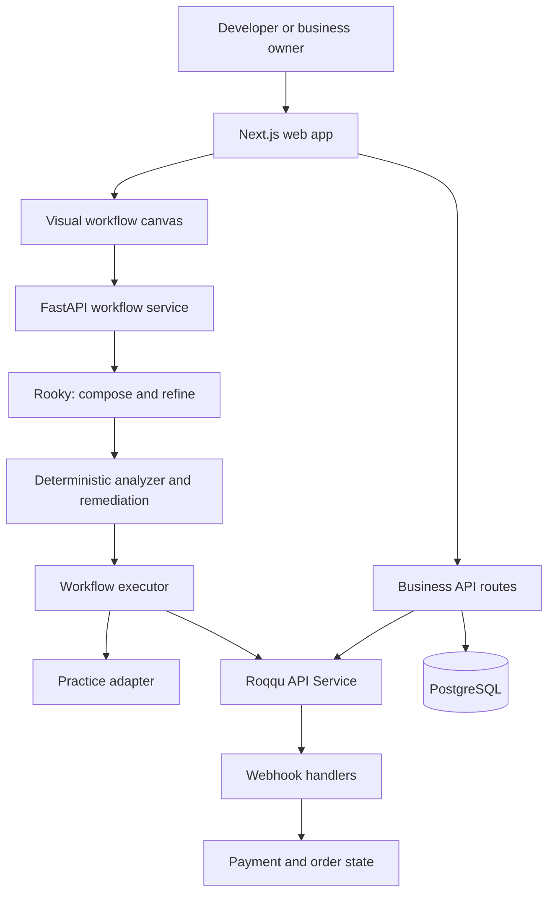

# Roqqu Studio

**Build crypto payment workflows from plain language. Review their safety before they run.**

Built for the **API Conference Lagos 2026 — Build With Roqqu Developer Challenge**.

[](https://github.com/Miss-shelby/Roqqu-Studio-/actions/workflows/ci.yml)
[](LICENSE)

### [Launch the live demo →](https://roqqu-studio-web.vercel.app/)

[Judge's walkthrough](#judges-walkthrough) · [Features](#features) · [Architecture](#architecture) · [Run locally](#run-locally) · [Configuration](#configuration)

## The problem

A successful API response is only one part of a reliable payment integration. Businesses still need to confirm deposits, prevent duplicate processing, validate amounts, and keep customers informed. Developers must connect these steps correctly; business owners need an interface they can use without writing code.

Roqqu Studio brings those needs together: a visual workspace for developers and practical payment tools for Nigerian businesses.

## The solution

Describe a payment flow to **Rooky**, the assistant, or start from a template. Studio represents the flow as a typed graph, checks it against deterministic safety rules, and helps repair supported issues through **Apply Fix**. Run the workflow in Practice mode, inspect its execution trace, and explore the Roqqu integration through an API playground.

For business owners, Studio also provides accounts, a product store, shareable checkout links, invoices, and a wallet dashboard.

**The core idea: AI proposes a workflow; deterministic code checks it.** The analyzer checks defined rules rather than treating an AI response as evidence that a payment flow is correct.

## Judge's walkthrough

Open the [live demo](https://roqqu-studio-web.vercel.app/). Feature availability depends on the deployment's backend, database, and configured integrations.

### 1. Build and review a workflow

1. Choose **I'm a developer** and start from a template, or ask Rooky:

   > Take a TRX payment to a fresh deposit address. When the Roqqu webhook arrives, verify the deposit, then send the customer a WhatsApp confirmation.

2. Inspect the generated nodes and connections on the canvas. Free-text composition requires an AI provider key; templates remain available without one.
3. Open **Architecture Review**, inspect a finding, and use **Apply Fix** where offered.
4. Run in **Practice mode** and follow the execution trace. Payment steps are simulated; notifications need separate configuration to be delivered.

**What to evaluate:** the editable workflow, visible safety findings, supported graph repairs, and traceable execution.

### 2. Explore the business experience

1. Open **[/studio/business](https://roqqu-studio-web.vercel.app/studio/business)** and create a business account.
2. Add products, open the store link, and create an invoice.
3. Inspect checkout and the wallet dashboard. Use the simulation controls in Practice or test mode to demonstrate the payment lifecycle without moving real funds.

Business accounts require a configured database. Simulated payment confirmations are demo behavior, not evidence of a real deposit.

### 3. Inspect the integration

Open **[/studio/playground](https://roqqu-studio-web.vercel.app/studio/playground)** to explore Roqqu endpoints, request parameters, code examples, and responses. Authenticated requests require server-side Roqqu credentials.

## Features

| Capability | What it provides |
| --- | --- |
| Visual workflow builder | A React Flow canvas with typed connections, editable node configuration, and starter templates. |
| Rooky assistant | Template routing without keys; free-text composition with a configured AI provider and an analyzer feedback loop. |
| Architecture Review | Deterministic findings for supported payment safety rules, with explanations and graph highlighting. |
| Apply Fix | Graph transformations that repair supported analyzer findings. |
| Execution trace | Step-by-step visibility into workflow runs, including simulated execution. |
| Business tools | Accounts, product listings, shareable stores, invoices, and a wallet dashboard backed by PostgreSQL. |
| Payment integration | Roqqu payment links, wallet addresses, balances, and transfers; BTC and USDT payment paths. |
| API playground | Endpoint exploration, request examples, and a downloadable JavaScript client. |
| Notifications | Optional email and WhatsApp integrations for workflow notifications. |

## Safety by design

The analyzer operates on workflow types and capability tags. Its checks include:

| Rule | Integration risk detected |
| --- | --- |
| `MON001` | A client callback is trusted as payment confirmation. |
| `MON002` | A webhook is processed without signature verification. |
| `MON003` | A financial effect lacks an idempotency boundary. |
| `MON004` | The amount paid is not validated against the expected amount. |
| `MON009` | A split occurs before the required fulfilment step. |
| `MON011` | A transfer beneficiary is not validated. |
| `MON012` | A payout has no preceding balance check. |

Production payment handling uses provider confirmation rather than a buyer's success screen. Practice and test simulations are separate paths. Live execution requires explicit configuration. Passing the analyzer means the defined checks passed; it does not certify every aspect of a payment system.

## Architecture



The FastAPI service manages workflow analysis and execution using in-memory state. Business accounts, stores, invoices, and wallet records use PostgreSQL through the Next.js server routes. These are separate persistence paths: restarting the API clears its in-memory workflow and execution state.

| Layer | Technologies |
| --- | --- |
| Frontend | Next.js, React, TypeScript, React Flow, Dagre |
| Workflow backend | Python, FastAPI, Pydantic |
| Business persistence | PostgreSQL; local PGlite option |
| AI adapters | Anthropic, OpenAI, Google, NVIDIA; keyword fallback |
| Integrations | Roqqu API Service, ZeptoMail, Evolution API |
| Verification | pytest, Vitest, TypeScript, Ruff, dependency audits |
| Deployment tooling | Docker Compose, Vercel-compatible web app, Cloud Run scripts |

## Run locally

### Option A: Docker Compose

Requires Git and Docker with Compose support.

```bash
git clone https://github.com/Miss-shelby/Roqqu-Studio-.git
cd Roqqu-Studio-
cp .env.example .env
docker compose up --build
```

Open the app at **http://localhost:3000**, the canvas at **http://localhost:3000/studio**, and the API docs at **http://localhost:8010/docs**.

The workflow canvas, templates, analyzer, and Practice runs work without external API keys. Full business features additionally require `DATABASE_URL` and session configuration; Compose does not provision a database.

### Option B: Run the services directly

Use **Python 3.11+**, **uv**, and **Node.js 22** (the version used by the project's CI and Docker web image).

```bash
# Terminal 1 — from the repository root
cd apps/api
uv sync --frozen --all-extras
uv run uvicorn roqqu_studio.api.main:app --host 127.0.0.1 --port 8010
```

```bash
# Terminal 2 — from the repository root
cd apps/web
cp .env.example .env.local
npm ci
npm run dev
```

For local business features, run `npm run db:local` from `apps/web` in another terminal and keep it running. Put its printed connection URL in `apps/web/.env.local` as `DATABASE_URL`, add a random `SESSION_SECRET` of at least 32 characters, and restart the web server. See [SETUP.md](SETUP.md) for hosted PostgreSQL and integration settings.

## Configuration

For Docker Compose, edit the root `.env`. For direct development, place backend settings in `apps/api/.env` and web settings in `apps/web/.env.local`. Keep private credentials on the server and out of version control.

| Feature | Settings |
| --- | --- |
| Free-text workflow composition | `AI_PROVIDER` and the corresponding `ANTHROPIC_API_KEY`, `OPENAI_API_KEY`, `GOOGLE_API_KEY`, or `NVIDIA_API_KEY` |
| Business accounts and persistent data | `DATABASE_URL`, `SESSION_SECRET` |
| Roqqu test integration | `RAS_TEST_KEY`; optionally `RAS_MODE=test` |
| Live Roqqu execution | `RAS_LIVE_KEY`, `RAS_MODE=live`, `ALLOW_PRODUCTION_EXECUTION=true` |
| Browser-to-backend connection | `NEXT_PUBLIC_API_URL`; `STUDIO_API_ORIGIN` for the same-origin proxy |
| Public store and payment URLs | `PUBLIC_APP_URL` |
| Email notifications | `ZEPTOMAIL_API_KEY`, `ZEPTOMAIL_SENDER`, `ZEPTOMAIL_REPLY_TO` |
| WhatsApp notifications | `EVOLUTION_API_URL`, `EVOLUTION_API_KEY`, `EVOLUTION_INSTANCE` |

Start with Practice mode or Roqqu test credentials. For business payment callbacks, configure the web application's `/api/ras/webhook` endpoint. The workflow backend has its own `/roqqu/webhook` route; use the endpoint appropriate to the integration being demonstrated. Detailed options are in [SETUP.md](SETUP.md) and [.env.example](.env.example).

## Verification

```bash
# Backend — from apps/api
uv run ruff check roqqu_studio tests
uv run pytest -q

# Frontend — from apps/web
npm run typecheck
npm test
npm run lint
```

To demonstrate the analyzer without starting a server, run these commands from `apps/api`:

```bash
uv run python scripts/demo_analyze.py
uv run python scripts/demo_remediate.py
```

**Current limits:** custom-code execution uses POSIX subprocess controls; use Linux, Docker, or WSL for that feature and its tests. Backend tests currently have four related failures on native Windows. The [import baseline CI run](https://github.com/Miss-shelby/Roqqu-Studio-/actions/runs/42089694422) failed during dependency auditing/install; a fully green pipeline has not been established. Check the [current Actions results](https://github.com/Miss-shelby/Roqqu-Studio-/actions) for the latest status.

## Project structure

```text
.
├── apps/
│   ├── api/                 # Workflow API, analyzer, assistant, executor, tests
│   └── web/                 # Canvas, business API routes, database schema, tests
├── docs/                    # Product, demo, and engineering documentation
├── scripts/                 # Deployment tooling
├── .github/workflows/       # CI and repository automation
├── docker-compose.yml       # Local web and API services
└── SETUP.md                 # Credentials, database, and deployment setup
```

## Documentation and contribution

- [Demo flows](docs/DEMO_FLOWS.md)
- [Rooky architecture](docs/ROOKY_ARCHITECTURE.md)
- [Build plan and decisions](docs/BUILD_PLAN.md)
- [Engineering standards](docs/ENGINEERING_STANDARDS.md)
- [Contribution guide](CONTRIBUTING.md)
- [Report an issue](https://github.com/Miss-shelby/Roqqu-Studio-/issues)

Contributions are welcome across engineering, design, documentation, and testing. Open an issue to discuss a change, then submit a focused pull request with relevant verification.

## License

Distributed under the [MIT License](LICENSE). The original copyright and permission notice is retained in `LICENSE`.
